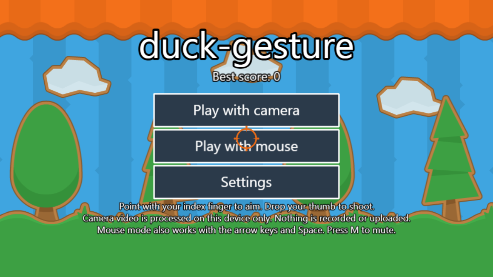
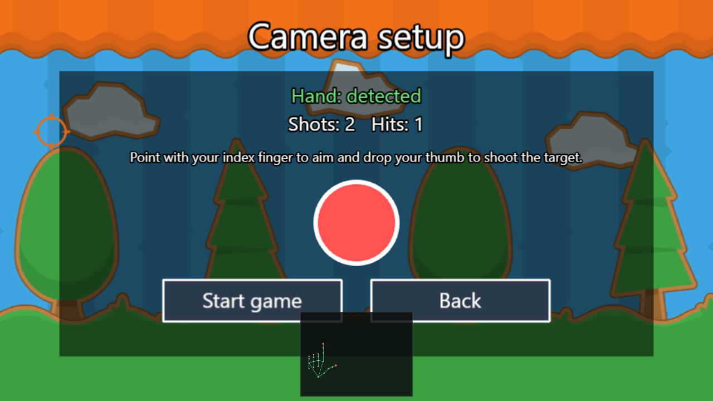
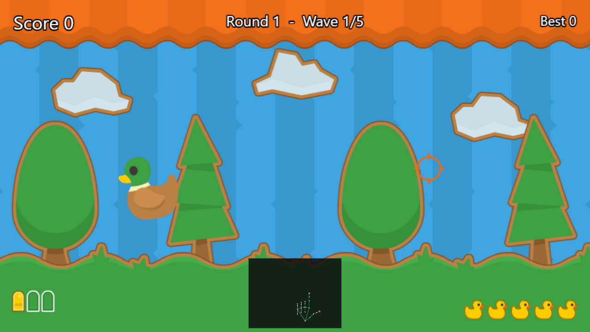
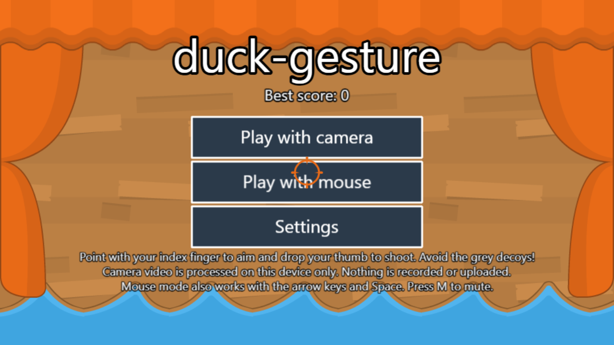
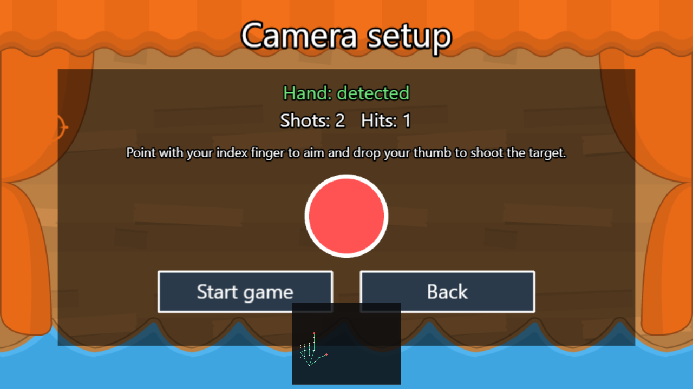
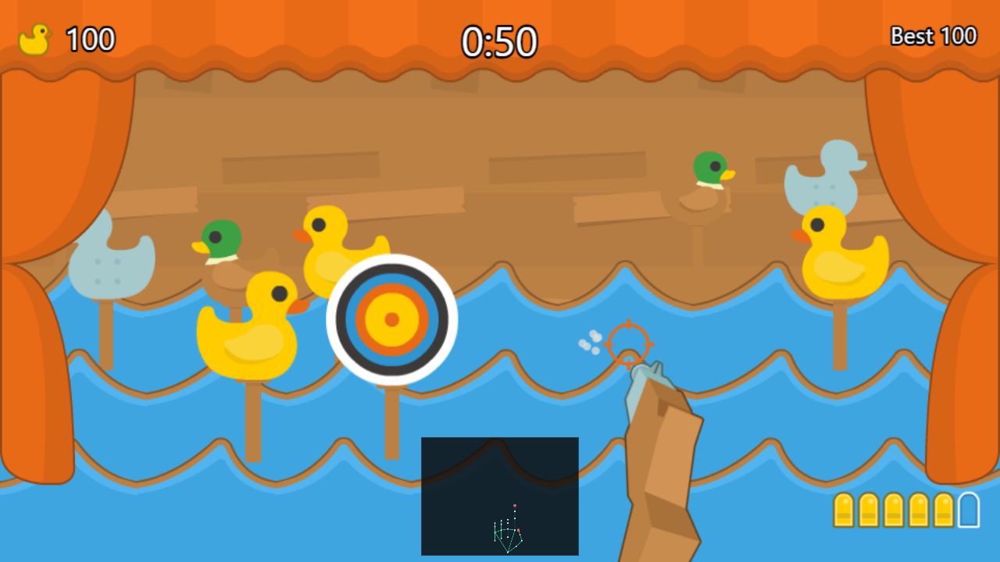

# duck-gesture

A carnival shooting gallery that you play with your hand in front of the camera: point with your index finger to aim and use a gesture to shoot. Everything runs in the browser: no server, no accounts, and the camera video never leaves your device.

> This project was built with the help of AI. For that reason, English is the primary language of the code, documentation and interface.

## How it works

- **Aim:** the tip of your index finger controls the crosshair, and a rifle on screen follows it.
- **Shoot:** one of two gestures, selectable in the settings.
  - `thumb`: drop your thumb like a hammer (default).
  - `recoil`: flick your hand upward like a pistol kick.
  - `both`: either gesture fires.
- **Fallback:** a mouse input provider lets you play without a camera.

## Gameplay

You have 60 seconds and a six-shot magazine that reloads automatically. Targets on sticks cross the water in three lanes, and more pop up from below:

| Target                  | Points                               |
| ----------------------- | ------------------------------------ |
| Yellow duck             | 100                                  |
| Mallard (faster)        | 150                                  |
| Bullseye                | 50, 100 or 200 depending on the ring |
| Golden duck (very fast) | 300 and +3 seconds                   |
| Grey decoy              | -150 and the streak is lost          |

Consecutive hits raise a score multiplier up to x4, and a miss resets it. The game gets faster, with more decoys and pop-ups, as the time runs out.

Hand tracking uses the MediaPipe Hand Landmarker. Gesture logic (One Euro Filter smoothing and a small state machine) is plain TypeScript, and the game itself is built with Phaser 3.

## Architecture

Three layers with one-way dependencies: `input → gestures → game`. The game never sees landmarks or MediaPipe, it only consumes typed events: `aim`, `shoot`, `poseChanged`, `trackingLost` and `trackingFound`.

```
src/
  core/       config, typed event bus, settings, shared types
  input/      camera, hand tracker and mouse input providers
  gestures/   filters, hand geometry, pose and shoot detection, state machine
  game/       Phaser scenes, entities, systems and UI
  assets/     logical asset manifest
```

## Tech stack

TypeScript (strict), Vite, pnpm, `@mediapipe/tasks-vision`, Phaser 3, Vitest, Playwright, ESLint and Prettier. Planned: PWA support via `vite-plugin-pwa` and hosting on Cloudflare Pages.

## Getting started

```bash
pnpm install
pnpm setup:mediapipe
pnpm dev
```

`pnpm setup:mediapipe` copies the MediaPipe WASM runtime and downloads the hand landmarker model so both are served from the application's own domain. To try the app from a phone on the local network, use `pnpm dev:https`.

`localhost` is allowed to use the camera without HTTPS. Other scripts:

| Command             | Description                                    |
| ------------------- | ---------------------------------------------- |
| `pnpm build`        | Typecheck and production build                 |
| `pnpm preview`      | Preview the production build                   |
| `pnpm typecheck`    | Run `tsc --noEmit`                             |
| `pnpm lint`         | Run ESLint                                     |
| `pnpm format`       | Run Prettier                                   |
| `pnpm test`         | Run unit tests with Vitest                     |
| `pnpm generate:sfx` | Regenerate the sound effects in `public/audio` |

## Screenshots

There are two game modes, each one in its own branch.

### Duck Hunter (branch `master`)

Rounds of waves where ducks fly across the sky and you get three shots per wave.

| Menu                                           | Camera setup                                                  | Gameplay                                               |
| ---------------------------------------------- | ------------------------------------------------------------- | ------------------------------------------------------ |
|  |  |  |

### Shooting gallery (branch `feature/shooting-gallery`)

A 60 second carnival stall with lanes of targets on sticks, pop-up targets, decoys and a rifle that follows your aim.

| Menu                                       | Camera setup                                              | Gameplay                                           |
| ------------------------------------------ | --------------------------------------------------------- | -------------------------------------------------- |
|  |  |  |

The camera screenshots use a simulated hand: opening the app with `?demo` replaces the camera with a synthetic hand skeleton that goes through the same gesture recognition and shoots on its own. `pnpm capture:screenshots` regenerates them against the preview server.

## Testing

Unit tests (`pnpm test`) cover the gesture logic and the game rules. End-to-end tests (`pnpm e2e`) run the production build in Chrome with a fake camera: they check that the app starts, reaches the menu, plays with the mouse, loads the hand tracking model, starts the camera and persists settings. They need `pnpm setup:mediapipe` to have been run once.

## Deployment

The app is a static site and is deployed on Cloudflare Pages with these settings:

| Setting                | Value                    |
| ---------------------- | ------------------------ |
| Build command          | `pnpm build:pages`       |
| Build output directory | `dist`                   |
| Node.js version        | 24 (see `.node-version`) |

`pnpm build:pages` downloads the hand tracking model and copies the WASM runtime before building, because those files are not stored in the repository. `public/_headers` sets long immutable caching for `/mediapipe`, `/models` and `/assets`, and no caching for the entry point and the service worker.

The app is also an installable PWA. The service worker precaches the application shell and caches the model and the WASM runtime the first time they are used, so the first visit is not delayed. Use `pnpm generate:icons` to regenerate the icons in `public/icons`.

## Privacy

The camera video is processed locally in your browser. Nothing is recorded or uploaded.

## Assets and licenses

Only freely licensed assets are used (CC0, such as the Kenney "Shooting Gallery" set). Every asset is listed in `CREDITS.md`. No Nintendo material is included.

## Status

The game is playable with the mouse or the camera: timed rounds, five target types, a magazine with reloading, streak scoring, sound effects, a stored high score, a settings screen and a camera setup screen. Measured performance numbers are tracked in `docs/perf.md`.
